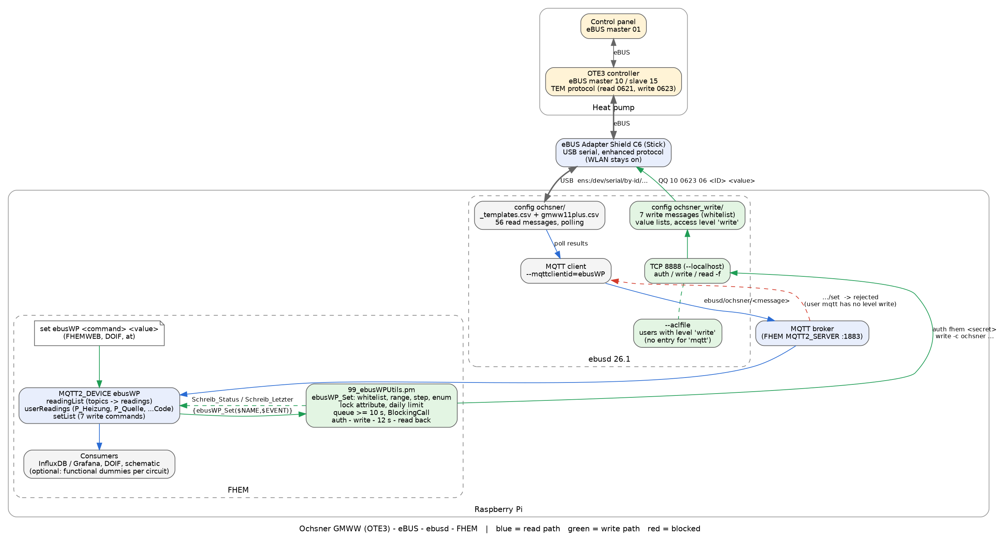

# FHEM Integration Example: Ochsner Heat Pump (OTE3) via ebusd

As of 2026-11-14 · ebusd 26.1 · FHEM (MQTT2_SERVER / MQTT2_DEVICE) · Ochsner GMWW 10, OTE3 SW 5.98  
German version: [fhem_integration_example_de.md](./fhem_integration_example_de.md)


> This document describes **one example** of how the eBUS data is used in FHEM. For the eBUS configuration itself
> (decoding, bus IDs, templates, write protection) see [ochsner_tem_protocol.md](./ochsner_tem_protocol.md). FHEM is not
> required — any MQTT-capable home automation can read the values; for writing, an FHEM module is used here.



## 1. Overview

| Path | Flow |
|---|---|
| **Read** (blue) | ebusd polls the heat pump → publishes every value via MQTT as `ebusd/ochsner/<message>` → FHEM broker `MQTT2_SERVER` → `MQTT2_DEVICE ebusWP` turns them into readings (`readingList`) |
| **Write** (green) | `set ebusWP <command> <value>` → Perl function `ebusWP_Set` (module `99_ebusWPUtils.pm`) validates and queues → a child process authenticates on the ebusd TCP port 8888 (`auth`), writes, and reads back after 12 s |
| **Blocked** (red) | MQTT `ebusd/ochsner/<message>/set` — ebusd does not execute it because the ACL user `mqtt` has no write level |

Why not write via MQTT? In a home network the broker is usually open to many devices (anonymous clients). Via the TCP port
with authentication only someone who knows the secret can write — and only the released messages with listed values.

## 2. ebusd

`/etc/default/ebusd` (adapt the device path to your adapter):
```
EBUSD_OPTS="--device=ens:/dev/serial/by-id/usb-Espressif_USB_JTAG_serial_debug_unit_XX:XX:XX:XX:XX:XX-if00 \
 --mqtthost=localhost --mqttport=1883 --pollinterval=1 \
 --configpath=/opt/fhem/ebusd_config/ochsner_gmww \
 --mqttclientid=ebusWP --localhost --aclfile=/etc/ebusd/acl"
```
| Option | Purpose |
|---|---|
| `--mqttclientid=ebusWP` | fixed client ID → FHEM autocreate creates **one** device `ebusWP` (otherwise a new `ebusd_<version>_<pid>` on every restart) |
| `--localhost` | TCP port 8888 reachable only locally |
| `--aclfile` | users allowed to write (level `write`) |
| `--configpath` | folder containing `ochsner/` (read) and `ochsner_write/` (write) |

Configuration files (from this repo): `configuration/ochsner/_templates.csv`, `gmww11plus.csv`,
`configuration/ochsner_write/gmww11plus_write.csv`. Write messages use the circuit `ochsner#write` and value lists.

`/etc/ebusd/acl` (root, 0600) — example `configuration/ochsner_write/acl.example`:
```
# name,secret,level
fhem,<random-hex-string>,write
```
Store the secret for FHEM as well: `/opt/fhem/.ebusd_secret` (owner `fhem`, mode 0600, only the string).
Create it e.g. with `openssl rand -hex 16`.

## 3. MQTT Broker in FHEM
```
define myBroker MQTT2_SERVER 1883 global
attr myBroker autocreate simple
```
After the first start of ebusd, `MQTT2_DEVICE ebusWP` is created automatically. `autocreate` builds the `readingList` with the
**full message names** as reading names (dots in the topic masked as `\x2e`). These names were kept on purpose: they contain
the OTE3 parameter code (e.g. `…05.051`) and can therefore be matched with the control panel unambiguously.

## 4. Device `ebusWP` (complete definition, as of 2026-11-14)

As raw definition (FHEMWEB → "Raw definition" or `fhem.cfg`). Reading names and comments are German (they follow the
Ochsner parameter names).

```
define ebusWP MQTT2_DEVICE ebusWP
attr ebusWP userattr ebusSchreibsperre:0,1
attr ebusWP ebusSchreibsperre 0
attr ebusWP event-on-update-reading .*
attr ebusWP readingList ebusWP:ebusd/global/version:.* version\
ebusWP:ebusd/global/running:.* running\
ebusWP:ebusd/ochsner/Waermepumpe\x2eDatum\x2e02\x2e070:.* Waermepumpe.Datum.02.070\
ebusWP:ebusd/ochsner/Waermepumpe\x2eUhrzeit\x2e02\x2e072:.* Waermepumpe.Uhrzeit.02.072\
ebusWP:ebusd/ochsner/Istwert\x2eHeizkreis\x2eVorlauftemp\x2e00\x2e002:.* Istwert.Heizkreis.Vorlauftemp.00.002\
ebusWP:ebusd/global/scan:.* scan\
ebusWP:ebusd/broadcast/datetime:.* datetime\
ebusWP:ebusd/ochsner/Warmwassertemp\x2eaktuell\x2e00\x2e004:.* Warmwassertemp.aktuell.00.004\
ebusWP:ebusd/global/uptime:.* uptime\
ebusWP:ebusd/global/signal:.* signal\
ebusWP:ebusd/ochsner/Vorlauftemp\x2eWaermepumpe\x2eTWV\x2e00\x2e007:.* Vorlauftemp.Waermepumpe.TWV.00.007\
ebusWP:ebusd/broadcast/error:.* error\
ebusWP:ebusd/ochsner/Ruecklauftemp\x2eWaermepumpe\x2eTWR\x2e00\x2e008:.* Ruecklauftemp.Waermepumpe.TWR.00.008\
ebusWP:ebusd/global/updatecheck:.* updatecheck\
ebusWP:ebusd/ochsner/Vorlauftemp\x2ePuffersp\x2eTPO\x2e00\x2e015:.* Vorlauftemp.Puffersp.TPO.00.015\
ebusWP:ebusd/ochsner/Vorlauftemp\x2ePuffersp\x2eTPM\x2e00\x2e017:.* Vorlauftemp.Puffersp.TPM.00.017\
ebusWP:ebusd/ochsner/Austrittstemp\x2eWaermequelle\x2eTQA\x2e00\x2e070:.* Austrittstemp.Waermequelle.TQA.00.070\
ebusWP:ebusd/ochsner/Aktuelle\x2eAussentemperatur\x2e00\x2e000:.* Aktuelle.Aussentemperatur.00.000\
ebusWP:ebusd/ochsner/Eintrittstemp\x2eWaermequelle\x2eTQE\x2e00\x2e071:.* Eintrittstemp.Waermequelle.TQE.00.071\
ebusWP:ebusd/ochsner/Status\x2eWaermeerzeugerpumpe\x2e01\x2e022:.* Status.Waermeerzeugerpumpe.01.022\
ebusWP:ebusd/ochsner/Drehzahl\x2eWaermeerzeugerpumpe\x2e01\x2e076:.* Drehzahl.Waermeerzeugerpumpe.01.076\
ebusWP:ebusd/ochsner/Aktueller\x2eRaumsollwert\x2e01\x2e001:.* Aktueller.Raumsollwert.01.001\
ebusWP:ebusd/ochsner/Sollwert\x2eHeizkreis\x2eVorlauftemp\x2e01\x2e002:.* Sollwert.Heizkreis.Vorlauftemp.01.002\
ebusWP:ebusd/ochsner/Warmwassertemp\x2eSOLL\x2eaktuell\x2e01\x2e004:.* Warmwassertemp.SOLL.aktuell.01.004\
ebusWP:ebusd/ochsner/Status\x2eHKR1\x2ePumpe\x2e01\x2e020:.* Status.HKR1.Pumpe.01.020\
ebusWP:ebusd/ochsner/Status\x2eHKR2\x2ePumpe\x2e01\x2e020:.* Status.HKR2.Pumpe.01.020\
ebusWP:ebusd/ochsner/Mischer\x2eHKR2\x2e01\x2e021:.* Mischer.HKR2.01.021\
ebusWP:ebusd/ochsner/Warmwasserbereitung\x2emit\x2eWaermepumpe\x2e01\x2e066:.* Warmwasserbereitung.mit.Waermepumpe.01.066\
ebusWP:ebusd/ochsner/Drehzahl\x2eWaermequellenpumpe\x2e01\x2e077:.* Drehzahl.Waermequellenpumpe.01.077\
ebusWP:ebusd/ochsner/Aussentemperatur\x2eMittelwert\x2e02\x2e020:.* Aussentemperatur.Mittelwert.02.020\
ebusWP:ebusd/ochsner/Status\x2eWarmwasser\x2e02\x2e052:.* Status.Warmwasser.02.052\
ebusWP:ebusd/ochsner/Fusspunkt\x2eVorlauftemp\x2eHeizen\x2e03\x2e001:.* Fusspunkt.Vorlauftemp.Heizen.03.001\
ebusWP:ebusd/ochsner/Norm\x2eAussentemperatur\x2e03\x2e012:.* Norm.Aussentemperatur.03.012\
ebusWP:ebusd/ochsner/Betriebswahl\x2eHeizkreis\x2e03\x2e050:.* Betriebswahl.Heizkreis.03.050\
ebusWP:ebusd/ochsner/Solltemperatur\x2eHeizbetrieb\x2e03\x2e051:.* Solltemperatur.Heizbetrieb.03.051\
ebusWP:ebusd/ochsner/Solltemperatur\x2eHeizbetrieb\x2eNacht\x2e03\x2e053:.* Solltemperatur.Heizbetrieb.Nacht.03.053\
ebusWP:ebusd/ochsner/Warmwassertemp\x2eSpar\x2e05\x2e086:.* Warmwassertemp.Spar.05.086\
ebusWP:ebusd/ochsner/Betriebswahl\x2eWaermepumpe\x2e09\x2e075:.* Betriebswahl.Waermepumpe.09.075\
ebusWP:ebusd/ochsner/Volumenstrom\x2eWaermenutzung\x2e21\x2e002:.* Volumenstrom.Waermenutzung.21.002\
ebusWP:ebusd/ochsner/Volumenstrom\x2eWaermequelle\x2e21\x2e090:.* Volumenstrom.Waermequelle.21.090\
ebusWP:ebusd/ochsner/Heizenergie\x2ekWh\x2e23\x2e001:.* Heizenergie.kWh.23.001\
ebusWP:ebusd/ochsner/Heizenergie\x2eMWh\x2e23\x2e010:.* Heizenergie.MWh.23.010\
ebusWP:ebusd/ochsner/Warmwasserenergie\x2ekWh\x2e23\x2e006:.* Warmwasserenergie.kWh.23.006\
ebusWP:ebusd/ochsner/Status\x2eWaermepumpe\x2e02\x2e053:.* Status.Waermepumpe.02.053\
ebusWP:ebusd/ochsner/Vorlauftemp\x2eAnlage\x2e00\x2e096:.* Vorlauftemp.Anlage.00.096\
ebusWP:ebusd/ochsner/Status\x2eHeizkreis\x2e02\x2e051:.* Status.Heizkreis.02.051\
ebusWP:ebusd/ochsner/Vorlauftemp\x2eNorm\x2eAussentemp\x2e03\x2e013:.* Vorlauftemp.Norm.Aussentemp.03.013\
ebusWP:ebusd/ochsner/Heizgrenze\x2e03\x2e021:.* Heizgrenze.03.021\
ebusWP:ebusd/ochsner/Betriebswahl\x2eWarmwasser\x2e05\x2e050:.* Betriebswahl.Warmwasser.05.050\
ebusWP:ebusd/ochsner/Warmwassertemp\x2eSOLL\x2e05\x2e051:.* Warmwassertemp.SOLL.05.051\
ebusWP:ebusd/ochsner/Warmwasserenergie\x2eMWh\x2e23\x2e013:.* Warmwasserenergie.MWh.23.013\
ebusWP:ebusd/scan\x2e06/:.* scan.06\
ebusWP:ebusd/scan\x2e08/:.* scan.08\
ebusWP:ebusd/scan\x2e15/:.* scan.15\
ebusWP:ebusd/ochsner/Status\x2eHKR2\x2e02\x2e051:.* Status.HKR2.02.051\
ebusWP:ebusd/ochsner/Istwert\x2eHKR2\x2eVorlauftemp\x2e00\x2e002:.* Istwert.HKR2.Vorlauftemp.00.002\
ebusWP:ebusd/ochsner/Aussentemperatur\x2eMittelwert\x2eHKR2\x2e02\x2e020:.* Aussentemperatur.Mittelwert.HKR2.02.020\
ebusWP:ebusd/ochsner/Raumsollwert\x2eHKR2\x2e01\x2e001:.* Raumsollwert.HKR2.01.001\
ebusWP:ebusd/ochsner/Sollwert\x2eHKR2\x2eVorlauftemp\x2e01\x2e002:.* Sollwert.HKR2.Vorlauftemp.01.002\
ebusWP:ebusd/ochsner/Waermepumpe\x2eSchaltzyklen\x2e02\x2e080:.* Waermepumpe.Schaltzyklen.02.080\
ebusWP:ebusd/ochsner/Waermepumpe\x2eBetriebsstunden\x2e02\x2e081:.* Waermepumpe.Betriebsstunden.02.081\
ebusWP:ebusd/broadcast/id:.* id\
ebusWP:ebusd/ochsner/Sollwert\x2eAnlage\x2e01\x2e096:.* Sollwert.Anlage.01.096\
ebusWP:ebusd/ochsner/Heizleistung\x2eHeizen\x2e02\x2e040:.* Heizleistung.Heizen.02.040\
ebusWP:ebusd/ochsner/Heizleistung\x2eWarmwasser\x2e02\x2e041:.* Heizleistung.Warmwasser.02.041\
ebusWP:ebusd/ochsner/Betriebswahl\x2eHKR2\x2e03\x2e050:.* Betriebswahl.HKR2.03.050\
ebusWP:ebusd/ochsner/Solltemp\x2eHandbetrieb\x2eHKR1\x2e07\x2e009:.* Solltemp.Handbetrieb.HKR1.07.009\
ebusWP:ebusd/ochsner/Solltemp\x2eHandbetrieb\x2eHKR2\x2e07\x2e009:.* Solltemp.Handbetrieb.HKR2.07.009
attr ebusWP room Heizung,MQTT2_DEVICE
attr ebusWP setList HKR1_Betriebswahl:Standbybetrieb,Automatik,Handbetrieb_Heizen {ebusWP_Set($NAME,$EVENT)}\
HKR2_Betriebswahl:Standbybetrieb,Automatik,Handbetrieb_Heizen {ebusWP_Set($NAME,$EVENT)}\
HKR1_Handsoll:slider,10,0.5,34 {ebusWP_Set($NAME,$EVENT)}\
HKR2_Handsoll:slider,10,0.5,34 {ebusWP_Set($NAME,$EVENT)}\
WW_Sollwert:slider,10,1,60 {ebusWP_Set($NAME,$EVENT)}\
WW_Betriebswahl:Keine_Ladung,Automatik,Normaltemperatur {ebusWP_Set($NAME,$EVENT)}\
WP_Uhrzeit_sync:noArg {ebusWP_Set($NAME,$EVENT)}
attr ebusWP userReadings P_Heizung:TWV|TWR|Waermenutzung {\
  # Thermische Heizleistung der Waermepumpe in kW (heizungsseitig).\
  # Formel: (Vorlauf TWV - Ruecklauf TWR) * Volumenstrom [l/min] * 4,182 kJ/(kg*K) / 60 s.\
  # Wird bei jeder Aktualisierung von TWV, TWR oder Volumenstrom Waermenutzung neu berechnet.\
  # Liefert nichts (undef), solange einer der drei Werte fehlt.\
  # Hinweis: kurzzeitig negative Werte moeglich, wenn die drei Werte zu leicht\
  # unterschiedlichen Zeitpunkten per eBUS eintreffen (Rechenartefakt).\
  my $TWV=ReadingsVal($name,"Vorlauftemp.Waermepumpe.TWV.00.007",undef);;\
  my $TWR=ReadingsVal($name,"Ruecklauftemp.Waermepumpe.TWR.00.008",undef);;\
  my $V=ReadingsVal($name,"Volumenstrom.Waermenutzung.21.002",undef);;\
  return undef unless defined $TWV && defined $TWR && defined $V;;\
  sprintf("%.3f",($TWV-$TWR)*$V*4.182/60)\
},\
P_Quelle:Waermequelle {\
  # Entzugsleistung aus der Waermequelle (Grundwasser) in kW.\
  # Formel: (Quell-Eintritt TQE - Quell-Austritt TQA) * Volumenstrom Quelle [l/min] * 4,182 / 60.\
  # Trigger: jede Aktualisierung eines Readings mit "Waermequelle" im Namen.\
  # Liefert nichts (undef), solange einer der drei Werte fehlt.\
  my $TQE=ReadingsVal($name,"Eintrittstemp.Waermequelle.TQE.00.071",undef);;\
  my $TQA=ReadingsVal($name,"Austrittstemp.Waermequelle.TQA.00.070",undef);;\
  my $V=ReadingsVal($name,"Volumenstrom.Waermequelle.21.090",undef);;\
  return undef unless defined $TQE && defined $TQA && defined $V;;\
  sprintf("%.3f",($TQE-$TQA)*$V*4.182/60)\
},\
Betriebswahl.Heizkreis.03.050.Code:Betriebswahl\.Heizkreis\.03\.050:.* {\
  # Betriebswahl Heizkreis 1 (OTE3-Parameter 03-050) als Zahl fuer InfluxDB/Grafana.\
  # ebusd liefert Klartext - der InfluxDB-Logger schreibt aber nur Zahlen.\
  # Trigger: FHEM prueft das ganze Event "Reading: Wert" - daher ":.*" am Ende.\
  # Codes laut Bedienteil (geprueft 23.10.2026):\
  #   0 = Standbybetrieb   1 = Automatik   4 = Normalbetrieb\
  #   5 = Sparbetrieb      7 = Handbetrieb Heizen\
  # Unbekannte Zahlen (falls ebusd keinen Text kennt) werden unveraendert uebernommen.\
  my %c=(Standbybetrieb=>0,Automatik=>1,Normalbetrieb=>4,Sparbetrieb=>5,Handbetrieb_Heizen=>7);;\
  my $v=ReadingsVal($name,"Betriebswahl.Heizkreis.03.050","");;\
  exists $c{$v} ? $c{$v} : ($v=~/^\d+$/ ? $v : undef)\
},\
Betriebswahl.HKR2.03.050.Code:Betriebswahl\.HKR2\.03\.050:.* {\
  # Betriebswahl Heizkreis 2 (OTE3-Parameter 03-050, Modul 4a) als Zahl fuer InfluxDB/Grafana.\
  # Trigger: FHEM prueft das ganze Event "Reading: Wert" - daher ":.*" am Ende.\
  # Gleiche Codes wie Heizkreis 1:\
  #   0 = Standbybetrieb   1 = Automatik   4 = Normalbetrieb\
  #   5 = Sparbetrieb      7 = Handbetrieb Heizen\
  # Hintergrund: stehen beide Heizkreise auf Standby, erwaermt die WP auch bei\
  # EVU-Vorrang kein Brauchwasser.\
  my %c=(Standbybetrieb=>0,Automatik=>1,Normalbetrieb=>4,Sparbetrieb=>5,Handbetrieb_Heizen=>7);;\
  my $v=ReadingsVal($name,"Betriebswahl.HKR2.03.050","");;\
  exists $c{$v} ? $c{$v} : ($v=~/^\d+$/ ? $v : undef)\
}
```

Attributes:

| Attribute | Content |
|---|---|
| `readingList` | 65 mappings topic → reading (heat pump values, ebusd status `version/running/signal/scan/uptime/updatecheck`, broadcasts `datetime/error/id`) |
| `userReadings` | `P_Heizung` / `P_Quelle`: thermal power from temperature difference × volume flow; `Betriebswahl.*.Code`: enum text → number for databases that store numbers only |
| `setList` | 7 write commands, all calling `{ebusWP_Set($NAME,$EVENT)}` — the function returns nothing, so **no** MQTT topic is published |
| `userattr ebusSchreibsperre:0,1` / `ebusSchreibsperre` | emergency stop for all write commands (1 = locked) |
| `event-on-update-reading .*` | every update creates an event (for logging / DOIF) |

**Pitfalls**
- userReadings trigger: FHEM matches the **whole** event "Reading: value" with `^…$` → trigger `Betriebswahl\.Heizkreis\.03\.050:.*` (with `:.*`), otherwise it never fires.
- In `readingList` write dots in topics as `\x2e` (autocreate does the same).
- No commas inside comments of ebusd CSV files (ebusd splits at every comma).

## 5. Module `99_ebusWPUtils.pm` (writing)

File: [`99_ebusWPUtils.pm`](../configuration/fhem/99_ebusWPUtils.pm) → copy to `/opt/fhem/FHEM/` (owner `fhem`), then
`reload 99_ebusWPUtils.pm` or restart FHEM (FHEM loads all `99_*Utils.pm` at start).

| Command | ebusd message | FHEM check |
|---|---|---|
| `HKR1_Betriebswahl` / `HKR2_Betriebswahl` | `Betriebswahl.Heizkreis.03.050` / `Betriebswahl.HKR2.03.050` | only `Standbybetrieb`, `Automatik`, `Handbetrieb_Heizen` |
| `HKR1_Handsoll` / `HKR2_Handsoll` | `Solltemp.Handbetrieb.HKR1.07.009` / `…HKR2…` | 10–34 °C, step 0.5 |
| `WW_Sollwert` | `Warmwassertemp.SOLL.05.051` | 10–60 °C, step 1 |
| `WW_Betriebswahl` | `Betriebswahl.Warmwasser.05.050` | only `Keine_Ladung`, `Automatik`, `Normaltemperatur` |
| `WP_Uhrzeit_sync` | `Waermepumpe.Uhrzeit.02.072` | no argument; only if the deviation is > 2 min, at the start of a minute, never 23:44–00:15 |

The limits (10–34 °C manual setpoint, 10–60 °C hot water) are the operator's choice — adapt them to your system
(the controller itself accepts e.g. 1–90 °C for the manual setpoint).

Flow:
1. `ebusWP_Set($NAME,$EVENT)` — check (whitelist, range, step, enum), lock, daily limit of 20 per command,
   "unchanged" if the reading already has the value → otherwise into the **queue**. If the same command is already waiting,
   only its value is replaced; max. 10 waiting jobs.
2. `ebusWP_Next` starts at most **one** job; at least **10 s** must have passed since the end of the previous one
   (otherwise an `InternalTimer` is set to the right moment).
3. `BlockingCall` → child process `ebusWP_Kind`: TCP `127.0.0.1:8888`, `auth fhem <secret>`, `write -c ochsner <message> <value>`
   (each command in its own packet — ebusd reads several lines in one packet as **one** command), wait 12 s, `read -f`, compare.
4. `ebusWP_Fertig` → readings `Schreib_Status` / `Schreib_Letzter`, log (level 3, errors level 1), next job.

Example (two commands directly one after the other):
```
16:00:00  set ebusWP WW_Betriebswahl Normaltemperatur   -> starts immediately
16:00:00  set ebusWP WW_Sollwert 60                     -> queued (1 waiting)
16:00:01  write operating mode   16:00:13 read back ok
16:00:23  write setpoint 60      16:00:35 read back ok
```

## 6. Commissioning and Tests (as performed)

1. Install the module, `attr ebusWP userattr ebusSchreibsperre:0,1`, **`attr ebusWP ebusSchreibsperre 1`**, set `setList`.
2. Test while locked: `set ebusWP HKR2_Betriebswahl Automatik` → `Schreib_Status: abgewiesen: Schreibsperre aktiv`.
3. Unlock (`… ebusSchreibsperre 0`), write a first value and check it on the control panel.
4. Invalid values → rejected by FHEM, ebusd log without `sent write`:
   `set ebusWP HKR2_Handsoll 30.3` (step), `set ebusWP WW_Sollwert 61` (range).

Test log 2026-11-14:
| Time | Command | Result |
|---|---|---|
| 09:18:55 | `HKR2_Betriebswahl Handbetrieb_Heizen` (locked) | rejected, no bus access |
| 09:21:17 | same (unlocked) | sent 09:21:17, read back 09:21:29 → ok; flow setpoint HKR2 28.7 → 30.0 °C |
| 09:25:59 | `HKR2_Handsoll 30.3` | rejected: not in step 0.5 |
| 09:26:07 | `WW_Sollwert 61` | rejected: outside 10-60 |

## 7. Use Case: Legionella Protection

The heat pump uses the hot water setpoint 05-051 only in the operating mode **Normaltemperatur**:
```
set ebusWP WW_Betriebswahl Normaltemperatur
set ebusWP WW_Sollwert 60
```
After 60 °C is reached (`Warmwassertemp.aktuell.00.004`) **set both back**, otherwise the tank is kept at 60 °C permanently:
```
set ebusWP WW_Betriebswahl Automatik
set ebusWP WW_Sollwert 43
```
During the charge both heating circuits report `Zwangsdrosselung` (hot water priority); the heat pump status stays `Heizbetrieb`.

## 8. Further Use in FHEM (examples)
- **InfluxDB/Grafana:** `InfluxDBLogger` writes the readings of `ebusWP` (measurement = reading name, tag = device).
  Enum texts as numbers via the `…Code` userReadings.
- **DOIF:** e.g. control of an electric heating element depending on `[ebusWP:Warmwassertemp.aktuell.00.004]`, reset logic of the
  utility priority contact depending on buffer and flow temperatures.
- **1-Wire sensors** (own flow/return sensors) complement the eBUS values; planned: functional devices per circuit (HKR1, HKR2, DHW, heat pump).
