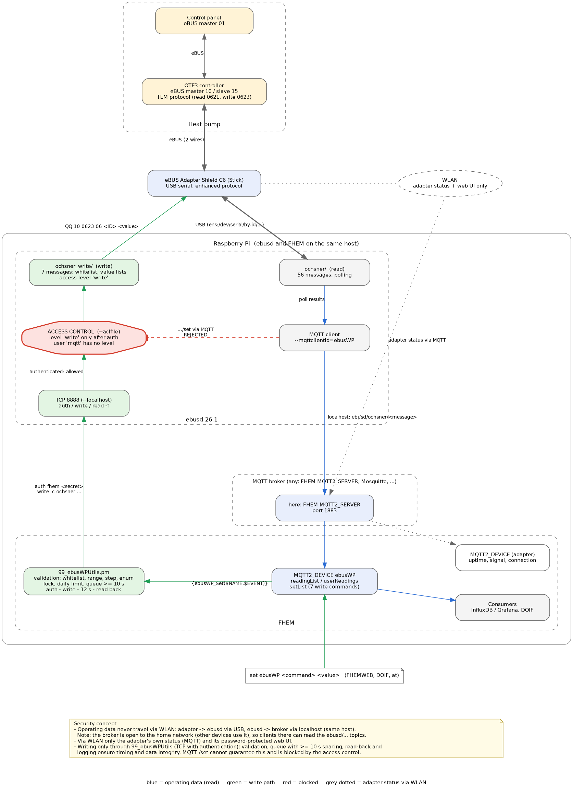

# FHEM-Integrationsbeispiel: Ochsner-Wärmepumpe (OTE3) über ebusd

Stand 2026-11-14 · ebusd 26.1 · FHEM (MQTT2_SERVER / MQTT2_DEVICE) · Ochsner GMWW 10, OTE3 SW 5.98  
English version: [fhem_integration_example.md](./fhem_integration_example.md)

> Dieses Dokument beschreibt **ein Beispiel**, wie die eBUS-Daten in FHEM genutzt werden. Für die eBUS-Konfiguration selbst
> (Dekodierung, Bus-IDs, Templates, Schreibschutz) siehe `docs/ochsner_tem_protocol.md`. FHEM ist nicht erforderlich —
> jede MQTT-fähige Hausautomation kann lesen; für das Schreiben wird hier ein FHEM-Modul verwendet.



## 1. Überblick

| Weg | Ablauf |
|---|---|
| **Lesen** (blau) | ebusd pollt die WP → veröffentlicht jeden Wert per MQTT unter `ebusd/ochsner/<Nachricht>` → FHEM-Broker `MQTT2_SERVER` → `MQTT2_DEVICE ebusWP` macht daraus Readings (`readingList`) |
| **Schreiben** (grün) | `set ebusWP <Befehl> <Wert>` → Perl-Funktion `ebusWP_Set` (Modul `99_ebusWPUtils.pm`) prüft und reiht ein → Kindprozess meldet sich an ebusd-TCP-Port 8888 an (`auth`), schreibt, liest nach 12 s zurück |
| **gesperrt** (rot) | MQTT `ebusd/ochsner/<Nachricht>/set` — ebusd führt es nicht aus, weil der ACL-Benutzer `mqtt` kein Schreibrecht hat |
| **Adapter-Status** (grau gepunktet) | Der Adapter meldet nur seinen **eigenen** Zustand (Laufzeit, Signal, Verbindung) per WLAN/MQTT an den Broker → eigenes MQTT2_DEVICE. Über WLAN läuft außerdem seine Weboberfläche (mit Passwort) |

**Sicherheitskonzept**
- **Betriebsdaten gehen nicht über WLAN:** Adapter → ebusd per USB, ebusd → Broker per `localhost` (gleicher Rechner).
  Einschränkung: Der Broker ist im Heimnetz erreichbar (andere Geräte nutzen ihn) — MQTT-Clients dort können die Topics
  `ebusd/…` **mitlesen**, aber nicht schreiben.
- **Schreiben nur über `99_ebusWPUtils`** (TCP mit Anmeldung): Prüfung, Warteschlange mit ≥ 10 s Abstand, Rücklesen und
  Protokoll stellen Timing und Datenintegrität sicher — das wäre über MQTT `/set` nicht möglich; die Zugriffskontrolle
  (`--aclfile`) sperrt diesen Weg deshalb.
- Der Broker ist austauschbar (hier FHEM `MQTT2_SERVER`, ebenso z. B. Mosquitto).

## 2. ebusd

`/etc/default/ebusd` (Gerätepfad an eigenen Adapter anpassen):
```
EBUSD_OPTS="--device=ens:/dev/serial/by-id/usb-Espressif_USB_JTAG_serial_debug_unit_XX:XX:XX:XX:XX:XX-if00 \
 --mqtthost=localhost --mqttport=1883 --pollinterval=1 \
 --configpath=/opt/fhem/ebusd_config/ochsner_gmww \
 --mqttclientid=ebusWP --localhost --aclfile=/etc/ebusd/acl"
```
| Option | Zweck |
|---|---|
| `--mqttclientid=ebusWP` | feste Client-ID → FHEM-autocreate legt **ein** Device `ebusWP` an (sonst bei jedem Neustart ein neues `ebusd_<version>_<pid>`) |
| `--localhost` | TCP-Port 8888 nur lokal erreichbar |
| `--aclfile` | Benutzer mit Schreibrecht (Level `write`) |
| `--configpath` | Ordner mit `ochsner/` (Lesen) und `ochsner_write/` (Schreiben) |

Konfigurationsdateien (aus diesem Repo): `configuration/ochsner/_templates.csv`, `gmww11plus.csv` (bzw. lokal `15.24849.csv`),
`configuration/ochsner_write/gmww11plus_write.csv`. Schreib-Nachrichten haben den Circuit `ochsner#write` und Wertelisten.

`/etc/ebusd/acl` (root, 0600) — Beispiel `configuration/ochsner_write/acl.example`:
```
# name,secret,level
fhem,<zufaellige-hex-zeichenkette>,write
```
Das Geheimnis zusätzlich für FHEM ablegen: `/opt/fhem/.ebusd_secret` (Besitzer `fhem`, Modus 0600, nur die Zeichenkette).
Erzeugen z. B. mit `openssl rand -hex 16`.

## 3. MQTT-Broker in FHEM
```
define myBroker MQTT2_SERVER 1883 global
attr myBroker autocreate simple
```
Nach dem ersten Start von ebusd entsteht automatisch `MQTT2_DEVICE ebusWP`. `autocreate` erzeugt die `readingList` mit
**vollen Nachrichtennamen** als Reading-Namen (Punkte im Topic als `\x2e` maskiert). Diese Namen wurden bewusst beibehalten:
sie enthalten den OTE3-Parametercode (z. B. `…05.051`) und sind damit eindeutig mit dem Bedienteil abgleichbar.

## 4. Device `ebusWP` (vollständige Definition, Stand 2026-11-14)

Als Rohdefinition (FHEMWEB → „Raw definition“ oder `fhem.cfg`):

```
define ebusWP MQTT2_DEVICE ebusWP
attr ebusWP userattr ebusSchreibsperre:0,1
attr ebusWP ebusSchreibsperre 0
attr ebusWP event-on-update-reading .*
attr ebusWP readingList ebusWP:ebusd/global/version:.* version\
ebusWP:ebusd/global/running:.* running\
ebusWP:ebusd/ochsner/Waermepumpe\x2eDatum\x2e02\x2e070:.* Waermepumpe.Datum.02.070\
ebusWP:ebusd/ochsner/Waermepumpe\x2eUhrzeit\x2e02\x2e072:.* Waermepumpe.Uhrzeit.02.072\
ebusWP:ebusd/ochsner/Istwert\x2eHeizkreis\x2eVorlauftemp\x2e00\x2e002:.* Istwert.Heizkreis.Vorlauftemp.00.002\
ebusWP:ebusd/global/scan:.* scan\
ebusWP:ebusd/broadcast/datetime:.* datetime\
ebusWP:ebusd/ochsner/Warmwassertemp\x2eaktuell\x2e00\x2e004:.* Warmwassertemp.aktuell.00.004\
ebusWP:ebusd/global/uptime:.* uptime\
ebusWP:ebusd/global/signal:.* signal\
ebusWP:ebusd/ochsner/Vorlauftemp\x2eWaermepumpe\x2eTWV\x2e00\x2e007:.* Vorlauftemp.Waermepumpe.TWV.00.007\
ebusWP:ebusd/broadcast/error:.* error\
ebusWP:ebusd/ochsner/Ruecklauftemp\x2eWaermepumpe\x2eTWR\x2e00\x2e008:.* Ruecklauftemp.Waermepumpe.TWR.00.008\
ebusWP:ebusd/global/updatecheck:.* updatecheck\
ebusWP:ebusd/ochsner/Vorlauftemp\x2ePuffersp\x2eTPO\x2e00\x2e015:.* Vorlauftemp.Puffersp.TPO.00.015\
ebusWP:ebusd/ochsner/Vorlauftemp\x2ePuffersp\x2eTPM\x2e00\x2e017:.* Vorlauftemp.Puffersp.TPM.00.017\
ebusWP:ebusd/ochsner/Austrittstemp\x2eWaermequelle\x2eTQA\x2e00\x2e070:.* Austrittstemp.Waermequelle.TQA.00.070\
ebusWP:ebusd/ochsner/Aktuelle\x2eAussentemperatur\x2e00\x2e000:.* Aktuelle.Aussentemperatur.00.000\
ebusWP:ebusd/ochsner/Eintrittstemp\x2eWaermequelle\x2eTQE\x2e00\x2e071:.* Eintrittstemp.Waermequelle.TQE.00.071\
ebusWP:ebusd/ochsner/Status\x2eWaermeerzeugerpumpe\x2e01\x2e022:.* Status.Waermeerzeugerpumpe.01.022\
ebusWP:ebusd/ochsner/Drehzahl\x2eWaermeerzeugerpumpe\x2e01\x2e076:.* Drehzahl.Waermeerzeugerpumpe.01.076\
ebusWP:ebusd/ochsner/Aktueller\x2eRaumsollwert\x2e01\x2e001:.* Aktueller.Raumsollwert.01.001\
ebusWP:ebusd/ochsner/Sollwert\x2eHeizkreis\x2eVorlauftemp\x2e01\x2e002:.* Sollwert.Heizkreis.Vorlauftemp.01.002\
ebusWP:ebusd/ochsner/Warmwassertemp\x2eSOLL\x2eaktuell\x2e01\x2e004:.* Warmwassertemp.SOLL.aktuell.01.004\
ebusWP:ebusd/ochsner/Status\x2eHKR1\x2ePumpe\x2e01\x2e020:.* Status.HKR1.Pumpe.01.020\
ebusWP:ebusd/ochsner/Status\x2eHKR2\x2ePumpe\x2e01\x2e020:.* Status.HKR2.Pumpe.01.020\
ebusWP:ebusd/ochsner/Mischer\x2eHKR2\x2e01\x2e021:.* Mischer.HKR2.01.021\
ebusWP:ebusd/ochsner/Warmwasserbereitung\x2emit\x2eWaermepumpe\x2e01\x2e066:.* Warmwasserbereitung.mit.Waermepumpe.01.066\
ebusWP:ebusd/ochsner/Drehzahl\x2eWaermequellenpumpe\x2e01\x2e077:.* Drehzahl.Waermequellenpumpe.01.077\
ebusWP:ebusd/ochsner/Aussentemperatur\x2eMittelwert\x2e02\x2e020:.* Aussentemperatur.Mittelwert.02.020\
ebusWP:ebusd/ochsner/Status\x2eWarmwasser\x2e02\x2e052:.* Status.Warmwasser.02.052\
ebusWP:ebusd/ochsner/Fusspunkt\x2eVorlauftemp\x2eHeizen\x2e03\x2e001:.* Fusspunkt.Vorlauftemp.Heizen.03.001\
ebusWP:ebusd/ochsner/Norm\x2eAussentemperatur\x2e03\x2e012:.* Norm.Aussentemperatur.03.012\
ebusWP:ebusd/ochsner/Betriebswahl\x2eHeizkreis\x2e03\x2e050:.* Betriebswahl.Heizkreis.03.050\
ebusWP:ebusd/ochsner/Solltemperatur\x2eHeizbetrieb\x2e03\x2e051:.* Solltemperatur.Heizbetrieb.03.051\
ebusWP:ebusd/ochsner/Solltemperatur\x2eHeizbetrieb\x2eNacht\x2e03\x2e053:.* Solltemperatur.Heizbetrieb.Nacht.03.053\
ebusWP:ebusd/ochsner/Warmwassertemp\x2eSpar\x2e05\x2e086:.* Warmwassertemp.Spar.05.086\
ebusWP:ebusd/ochsner/Betriebswahl\x2eWaermepumpe\x2e09\x2e075:.* Betriebswahl.Waermepumpe.09.075\
ebusWP:ebusd/ochsner/Volumenstrom\x2eWaermenutzung\x2e21\x2e002:.* Volumenstrom.Waermenutzung.21.002\
ebusWP:ebusd/ochsner/Volumenstrom\x2eWaermequelle\x2e21\x2e090:.* Volumenstrom.Waermequelle.21.090\
ebusWP:ebusd/ochsner/Heizenergie\x2ekWh\x2e23\x2e001:.* Heizenergie.kWh.23.001\
ebusWP:ebusd/ochsner/Heizenergie\x2eMWh\x2e23\x2e010:.* Heizenergie.MWh.23.010\
ebusWP:ebusd/ochsner/Warmwasserenergie\x2ekWh\x2e23\x2e006:.* Warmwasserenergie.kWh.23.006\
ebusWP:ebusd/ochsner/Status\x2eWaermepumpe\x2e02\x2e053:.* Status.Waermepumpe.02.053\
ebusWP:ebusd/ochsner/Vorlauftemp\x2eAnlage\x2e00\x2e096:.* Vorlauftemp.Anlage.00.096\
ebusWP:ebusd/ochsner/Status\x2eHeizkreis\x2e02\x2e051:.* Status.Heizkreis.02.051\
ebusWP:ebusd/ochsner/Vorlauftemp\x2eNorm\x2eAussentemp\x2e03\x2e013:.* Vorlauftemp.Norm.Aussentemp.03.013\
ebusWP:ebusd/ochsner/Heizgrenze\x2e03\x2e021:.* Heizgrenze.03.021\
ebusWP:ebusd/ochsner/Betriebswahl\x2eWarmwasser\x2e05\x2e050:.* Betriebswahl.Warmwasser.05.050\
ebusWP:ebusd/ochsner/Warmwassertemp\x2eSOLL\x2e05\x2e051:.* Warmwassertemp.SOLL.05.051\
ebusWP:ebusd/ochsner/Warmwasserenergie\x2eMWh\x2e23\x2e013:.* Warmwasserenergie.MWh.23.013\
ebusWP:ebusd/scan\x2e06/:.* scan.06\
ebusWP:ebusd/scan\x2e08/:.* scan.08\
ebusWP:ebusd/scan\x2e15/:.* scan.15\
ebusWP:ebusd/ochsner/Status\x2eHKR2\x2e02\x2e051:.* Status.HKR2.02.051\
ebusWP:ebusd/ochsner/Istwert\x2eHKR2\x2eVorlauftemp\x2e00\x2e002:.* Istwert.HKR2.Vorlauftemp.00.002\
ebusWP:ebusd/ochsner/Aussentemperatur\x2eMittelwert\x2eHKR2\x2e02\x2e020:.* Aussentemperatur.Mittelwert.HKR2.02.020\
ebusWP:ebusd/ochsner/Raumsollwert\x2eHKR2\x2e01\x2e001:.* Raumsollwert.HKR2.01.001\
ebusWP:ebusd/ochsner/Sollwert\x2eHKR2\x2eVorlauftemp\x2e01\x2e002:.* Sollwert.HKR2.Vorlauftemp.01.002\
ebusWP:ebusd/ochsner/Waermepumpe\x2eSchaltzyklen\x2e02\x2e080:.* Waermepumpe.Schaltzyklen.02.080\
ebusWP:ebusd/ochsner/Waermepumpe\x2eBetriebsstunden\x2e02\x2e081:.* Waermepumpe.Betriebsstunden.02.081\
ebusWP:ebusd/broadcast/id:.* id\
ebusWP:ebusd/ochsner/Sollwert\x2eAnlage\x2e01\x2e096:.* Sollwert.Anlage.01.096\
ebusWP:ebusd/ochsner/Heizleistung\x2eHeizen\x2e02\x2e040:.* Heizleistung.Heizen.02.040\
ebusWP:ebusd/ochsner/Heizleistung\x2eWarmwasser\x2e02\x2e041:.* Heizleistung.Warmwasser.02.041\
ebusWP:ebusd/ochsner/Betriebswahl\x2eHKR2\x2e03\x2e050:.* Betriebswahl.HKR2.03.050\
ebusWP:ebusd/ochsner/Solltemp\x2eHandbetrieb\x2eHKR1\x2e07\x2e009:.* Solltemp.Handbetrieb.HKR1.07.009\
ebusWP:ebusd/ochsner/Solltemp\x2eHandbetrieb\x2eHKR2\x2e07\x2e009:.* Solltemp.Handbetrieb.HKR2.07.009
attr ebusWP room Heizung,MQTT2_DEVICE
attr ebusWP setList HKR1_Betriebswahl:Standbybetrieb,Automatik,Handbetrieb_Heizen {ebusWP_Set($NAME,$EVENT)}\
HKR2_Betriebswahl:Standbybetrieb,Automatik,Handbetrieb_Heizen {ebusWP_Set($NAME,$EVENT)}\
HKR1_Handsoll:slider,10,0.5,34 {ebusWP_Set($NAME,$EVENT)}\
HKR2_Handsoll:slider,10,0.5,34 {ebusWP_Set($NAME,$EVENT)}\
WW_Sollwert:slider,10,1,60 {ebusWP_Set($NAME,$EVENT)}\
WW_Betriebswahl:Keine_Ladung,Automatik,Normaltemperatur {ebusWP_Set($NAME,$EVENT)}\
WP_Uhrzeit_sync:noArg {ebusWP_Set($NAME,$EVENT)}
attr ebusWP userReadings P_Heizung:TWV|TWR|Waermenutzung {\
  # Thermische Heizleistung der Waermepumpe in kW (heizungsseitig).\
  # Formel: (Vorlauf TWV - Ruecklauf TWR) * Volumenstrom [l/min] * 4,182 kJ/(kg*K) / 60 s.\
  # Wird bei jeder Aktualisierung von TWV, TWR oder Volumenstrom Waermenutzung neu berechnet.\
  # Liefert nichts (undef), solange einer der drei Werte fehlt.\
  # Hinweis: kurzzeitig negative Werte moeglich, wenn die drei Werte zu leicht\
  # unterschiedlichen Zeitpunkten per eBUS eintreffen (Rechenartefakt).\
  my $TWV=ReadingsVal($name,"Vorlauftemp.Waermepumpe.TWV.00.007",undef);;\
  my $TWR=ReadingsVal($name,"Ruecklauftemp.Waermepumpe.TWR.00.008",undef);;\
  my $V=ReadingsVal($name,"Volumenstrom.Waermenutzung.21.002",undef);;\
  return undef unless defined $TWV && defined $TWR && defined $V;;\
  sprintf("%.3f",($TWV-$TWR)*$V*4.182/60)\
},\
P_Quelle:Waermequelle {\
  # Entzugsleistung aus der Waermequelle (Grundwasser) in kW.\
  # Formel: (Quell-Eintritt TQE - Quell-Austritt TQA) * Volumenstrom Quelle [l/min] * 4,182 / 60.\
  # Trigger: jede Aktualisierung eines Readings mit "Waermequelle" im Namen.\
  # Liefert nichts (undef), solange einer der drei Werte fehlt.\
  my $TQE=ReadingsVal($name,"Eintrittstemp.Waermequelle.TQE.00.071",undef);;\
  my $TQA=ReadingsVal($name,"Austrittstemp.Waermequelle.TQA.00.070",undef);;\
  my $V=ReadingsVal($name,"Volumenstrom.Waermequelle.21.090",undef);;\
  return undef unless defined $TQE && defined $TQA && defined $V;;\
  sprintf("%.3f",($TQE-$TQA)*$V*4.182/60)\
},\
Betriebswahl.Heizkreis.03.050.Code:Betriebswahl\.Heizkreis\.03\.050:.* {\
  # Betriebswahl Heizkreis 1 (OTE3-Parameter 03-050) als Zahl fuer InfluxDB/Grafana.\
  # ebusd liefert Klartext - der InfluxDB-Logger schreibt aber nur Zahlen.\
  # Trigger: FHEM prueft das ganze Event "Reading: Wert" - daher ":.*" am Ende.\
  # Codes laut Bedienteil (geprueft 23.10.2026):\
  #   0 = Standbybetrieb   1 = Automatik   4 = Normalbetrieb\
  #   5 = Sparbetrieb      7 = Handbetrieb Heizen\
  # Unbekannte Zahlen (falls ebusd keinen Text kennt) werden unveraendert uebernommen.\
  my %c=(Standbybetrieb=>0,Automatik=>1,Normalbetrieb=>4,Sparbetrieb=>5,Handbetrieb_Heizen=>7);;\
  my $v=ReadingsVal($name,"Betriebswahl.Heizkreis.03.050","");;\
  exists $c{$v} ? $c{$v} : ($v=~/^\d+$/ ? $v : undef)\
},\
Betriebswahl.HKR2.03.050.Code:Betriebswahl\.HKR2\.03\.050:.* {\
  # Betriebswahl Heizkreis 2 (OTE3-Parameter 03-050, Modul 4a) als Zahl fuer InfluxDB/Grafana.\
  # Trigger: FHEM prueft das ganze Event "Reading: Wert" - daher ":.*" am Ende.\
  # Gleiche Codes wie Heizkreis 1:\
  #   0 = Standbybetrieb   1 = Automatik   4 = Normalbetrieb\
  #   5 = Sparbetrieb      7 = Handbetrieb Heizen\
  # Hintergrund: stehen beide Heizkreise auf Standby, erwaermt die WP auch bei\
  # EVU-Vorrang kein Brauchwasser.\
  my %c=(Standbybetrieb=>0,Automatik=>1,Normalbetrieb=>4,Sparbetrieb=>5,Handbetrieb_Heizen=>7);;\
  my $v=ReadingsVal($name,"Betriebswahl.HKR2.03.050","");;\
  exists $c{$v} ? $c{$v} : ($v=~/^\d+$/ ? $v : undef)\
}
```

Erläuterung der Attribute:

| Attribut | Inhalt |
|---|---|
| `readingList` | 65 Zuordnungen Topic → Reading (Werte der WP, ebusd-Status `version/running/signal/scan/uptime/updatecheck`, Broadcasts `datetime/error/id`) |
| `userReadings` | `P_Heizung` / `P_Quelle`: thermische Leistung aus Temperaturdifferenz × Volumenstrom; `Betriebswahl.*.Code`: Enum-Text → Zahl für Datenbanken, die nur Zahlen speichern |
| `setList` | 7 Schreibbefehle, alle rufen `{ebusWP_Set($NAME,$EVENT)}` auf — die Funktion gibt nichts zurück, daher wird **kein** MQTT-Topic veröffentlicht |
| `userattr ebusSchreibsperre:0,1` / `ebusSchreibsperre` | Not-Aus für alle Schreibbefehle (1 = gesperrt) |
| `event-on-update-reading .*` | jedes Update erzeugt ein Event (für Logging/DOIF) |

**Fallen beim Nachbau**
- userReadings-Trigger: FHEM prüft das **ganze** Event „Reading: Wert“ mit `^…$` → Trigger `Betriebswahl\.Heizkreis\.03\.050:.*` (mit `:.*`), sonst feuert er nie.
- In `readingList` Punkte im Topic als `\x2e` schreiben (so legt autocreate sie auch an).
- In ebusd-CSV-Dateien keine Kommas in Kommentaren (ebusd trennt an jedem Komma).

## 5. Modul `99_ebusWPUtils.pm` (Schreiben)

Datei: [`99_ebusWPUtils.pm`](../configuration/fhem/99_ebusWPUtils.pm) → nach `/opt/fhem/FHEM/` kopieren (Besitzer `fhem`), dann `reload 99_ebusWPUtils.pm`
oder FHEM-Neustart (FHEM lädt alle `99_*Utils.pm` beim Start).

| Befehl | ebusd-Nachricht | FHEM-Prüfung |
|---|---|---|
| `HKR1_Betriebswahl` / `HKR2_Betriebswahl` | `Betriebswahl.Heizkreis.03.050` / `Betriebswahl.HKR2.03.050` | nur `Standbybetrieb`, `Automatik`, `Handbetrieb_Heizen` |
| `HKR1_Handsoll` / `HKR2_Handsoll` | `Solltemp.Handbetrieb.HKR1.07.009` / `…HKR2…` | 10–34 °C, Raster 0,5 |
| `WW_Sollwert` | `Warmwassertemp.SOLL.05.051` | 10–60 °C, Raster 1 |
| `WW_Betriebswahl` | `Betriebswahl.Warmwasser.05.050` | nur `Keine_Ladung`, `Automatik`, `Normaltemperatur` |
| `WP_Uhrzeit_sync` | `Waermepumpe.Uhrzeit.02.072` | ohne Argument; nur bei > 2 min Abweichung, zum Minutenbeginn, nie 23:44–00:15 |

Ablauf:
1. `ebusWP_Set($NAME,$EVENT)` — Prüfung (Whitelist, Bereich, Raster, Enum), Sperre, Tageslimit 20 je Befehl,
   „unverändert“ wenn das Reading schon den Wert hat → sonst in die **Warteschlange**. Wartet derselbe Befehl schon, wird nur
   sein Wert ersetzt; max. 10 wartende Aufträge.
2. `ebusWP_Next` startet höchstens **einen** Auftrag; seit dem Ende des letzten müssen **≥ 10 s** vergangen sein
   (sonst `InternalTimer` auf den passenden Zeitpunkt).
3. `BlockingCall` → Kindprozess `ebusWP_Kind`: TCP `127.0.0.1:8888`, `auth fhem <secret>`, `write -c ochsner <Nachricht> <Wert>`
   (jeder Befehl ein eigenes Paket — ebusd liest mehrere Zeilen in einem Paket als **einen** Befehl), 12 s warten, `read -f`, Vergleich.
4. `ebusWP_Fertig` → Readings `Schreib_Status` / `Schreib_Letzter`, Log (Level 3, Fehler Level 1), nächster Auftrag.

Beispiel (zwei Befehle direkt hintereinander):
```
16:00:00  set ebusWP WW_Betriebswahl Normaltemperatur   -> startet sofort
16:00:00  set ebusWP WW_Sollwert 60                     -> eingereiht (1 in Warteschlange)
16:00:01  write Betriebswahl     16:00:13 Ruecklesen ok
16:00:23  write Sollwert 60      16:00:35 Ruecklesen ok
```

## 6. Inbetriebnahme und Tests (so durchgeführt)

1. Modul installieren, `attr ebusWP userattr ebusSchreibsperre:0,1`, **`attr ebusWP ebusSchreibsperre 1`**, `setList` setzen.
2. Test bei Sperre: `set ebusWP HKR2_Betriebswahl Automatik` → `Schreib_Status: abgewiesen: Schreibsperre aktiv`.
3. Sperre lösen (`… ebusSchreibsperre 0`), ersten Wert schreiben und am Bedienteil kontrollieren.
4. Ungültige Werte → von FHEM abgewiesen, ebusd-Log ohne `sent write`:
   `set ebusWP HKR2_Handsoll 30.3` (Raster), `set ebusWP WW_Sollwert 61` (Bereich).

Protokoll der Tests 2026-11-14:
| Zeit | Befehl | Ergebnis |
|---|---|---|
| 09:18:55 | `HKR2_Betriebswahl Handbetrieb_Heizen` (Sperre 1) | abgewiesen, kein Buszugriff |
| 09:21:17 | dito (Sperre 0) | gesendet 09:21:17, Rücklesen 09:21:29 → ok; VL-Soll HKR2 28,7 → 30,0 °C |
| 09:25:59 | `HKR2_Handsoll 30.3` | abgewiesen: nicht im Raster 0.5 |
| 09:26:07 | `WW_Sollwert 61` | abgewiesen: ausserhalb 10-60 |

## 7. Anwendungsbeispiel Legionellenschutz

Die WP übernimmt den Warmwasser-Sollwert 05-051 nur in der Betriebswahl **Normaltemperatur**:
```
set ebusWP WW_Betriebswahl Normaltemperatur
set ebusWP WW_Sollwert 60
```
Nach Erreichen von 60 °C (`Warmwassertemp.aktuell.00.004`) **beides zurückstellen**, sonst hält die WP dauerhaft 60 °C:
```
set ebusWP WW_Betriebswahl Automatik
set ebusWP WW_Sollwert 43
```
Während der Ladung melden beide Heizkreise `Zwangsdrosselung` (Warmwasser-Vorrang), der WP-Status bleibt `Heizbetrieb`.

## 8. Weitere Nutzung in FHEM (Beispiele)
- **InfluxDB/Grafana:** `InfluxDBLogger` schreibt die Readings von `ebusWP` (Messreihe = Reading-Name, Tag = Device).
  Textwerte verwirft der Logger: Ein/Aus (Pumpen, WW-Bereitung) werden per Attribut umgewandelt —
  `attr InfluxDB conversions …,^on$=1,^off$=0,^Ein$=1,^Aus$=0` (wirkt auf alle Devices); Enum-Texte über die `…Code`-userReadings als Zahl.
- **DOIF:** z. B. Heizstab-Steuerung nach `[ebusWP:Warmwassertemp.aktuell.00.004]`, Rücksetzlogik des EVU-Kontakts nach
  Puffer- und Vorlauftemperaturen.
- **1-Wire-Fühler** (eigene Vor-/Rückläufe) ergänzen die eBUS-Werte; geplant: Funktions-Devices je Kreis (HKR1, HKR2, WW, WP).
